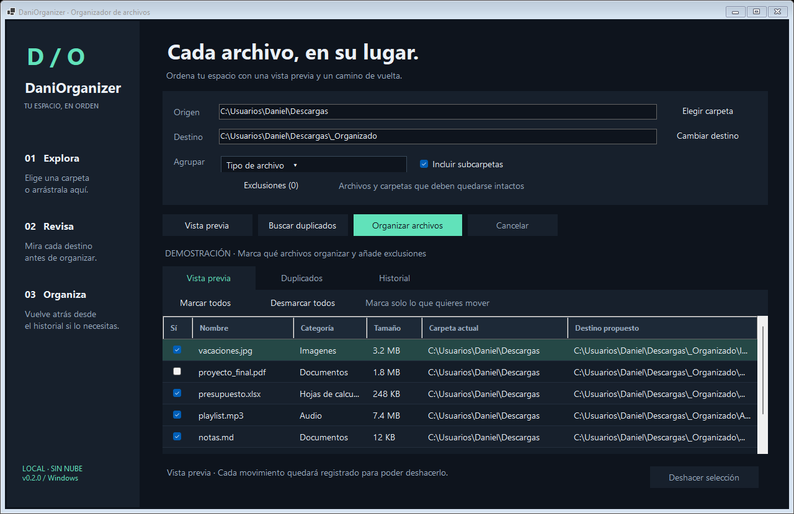

# DaniOrganizer

**Cada archivo, en su lugar.** Organizador de archivos para Windows, con interfaz de escritorio en español y procesamiento local.

[Descargar para Windows x64](https://github.com/Martinez2319/DaniOrganizer/releases/latest)



## Qué hace la versión 0.2.0

- Organiza por **tipo**, **mes de modificación** o **tipo y mes**.
- Muestra origen, destino y tamaño de cada archivo antes de moverlo.
- Permite marcar individualmente qué archivos organizar, con **Marcar todos** y **Desmarcar todos**.
- Guarda exclusiones de archivos y carpetas completas, también para la búsqueda de duplicados.
- Busca duplicados por tamaño y **SHA-256 del contenido**, aunque sus nombres sean distintos. Esta versión solo los muestra; no los elimina.
- Evita sobrescribir archivos: propone nombres con sufijos cuando coinciden.
- Guarda un historial persistente y permite deshacer una operación después de reiniciar la aplicación.
- Permite cancelar, arrastrar una carpeta a la ventana y mostrar archivos en el Explorador con doble clic.

## Empezar

1. Descarga y extrae **todo el ZIP** de la Release.
2. Abre `DaniOrganizer.exe`. El paquete incluye .NET; no necesitas instalarlo.
3. Elige el origen. El destino propuesto es `_Organizado` dentro de esa carpeta; también puedes elegir otra carpeta separada.
4. Elige la agrupación y si quieres incluir subcarpetas.
5. Si hay archivos o carpetas que quieras dejar intactos, pulsa **Exclusiones**, añádelos y guarda la lista.
6. Pulsa **Vista previa**. En la columna **Sí**, desmarca lo que no quieras mover. Puedes usar **Desmarcar todos** y marcar solo los archivos deseados. El contador muestra cuántos se organizarán.
7. Revisa los destinos y pulsa **Organizar (cantidad)**. Solo se moverán los archivos marcados.
8. Para volver atrás, abre **Historial**, selecciona la operación y pulsa **Deshacer selección**.

Las casillas se reinician al generar una nueva vista previa. Para omitir algo siempre, usa **Exclusiones**: puedes añadir varios archivos, una carpeta con todo su contenido, o quitar entradas de la lista. Las reglas se conservan al cerrar y abrir la aplicación. Cambiarlas invalida la vista previa y obliga a revisarla de nuevo. Se guardan como rutas completas en `%LOCALAPPDATA%\DaniOrganizer\exclusions.json`.

**Buscar duplicados** no necesita aplicar la vista previa. Los duplicados se muestran en grupos; el espacio indicado corresponde a copias repetidas, no a espacio que se haya liberado.

## Cómo protege los archivos

La vista previa no modifica archivos. Antes de organizar se comprueba que los archivos seleccionados no hayan cambiado desde el análisis y que sus destinos sigan libres. Los archivos desmarcados y las rutas excluidas no se mueven. Cada movimiento se registra antes y después de ejecutarlo. Si una operación falla o se cancela, puede quedar parcialmente completada; el historial permite deshacer los movimientos registrados.

Al deshacer, el contenido se verifica por SHA-256. Si el destino cambió o el origen está ocupado, se omite ese archivo y se informa del motivo. Una operación puede volver a intentarse desde el historial después de resolver los avisos. Las carpetas vacías creadas por la organización se conservan.

Se omiten archivos/carpetas ocultos, de sistema y enlaces o puntos de reanálisis. También se excluyen `.git`, `.svn`, `.hg`, `node_modules`, `.venv`, `venv`, `bin` y `obj`. El destino se excluye del análisis recursivo. Los avisos muestran lo que no pudo analizarse.

Los meses se calculan con la **fecha de modificación local**, no con EXIF. Los archivos se mueven a carpetas de categorías; la estructura original de subcarpetas no se replica. El historial se guarda en `%LOCALAPPDATA%\DaniOrganizer\operations\` y contiene rutas locales y huellas de contenido. No se envían archivos a la nube.

## Desarrollo

Requisitos: Windows y SDK de .NET 8.

```powershell
dotnet build DaniOrganizer.sln -c Release
dotnet run --project Tests/DaniOrganizer.Tests.csproj -c Release
dotnet run --project Desktop/DaniOrganizer.csproj -c Release
dotnet publish Desktop/DaniOrganizer.csproj -c Release -r win-x64 --self-contained true -o artifacts/portable
```

Hay **24 pruebas** del motor: vista previa, selección parcial, exclusiones, persistencia, límites de carpetas y raíces de unidad, colisiones, subcarpetas, fechas, movimientos, recuperación del registro, deshacer, cambios concurrentes, duplicados y cancelación. El ejecutable admite `--ui-smoke` para comprobar el recorrido de escritorio completo, incluidas casillas, exclusiones guardadas y organización selectiva, usando exclusivamente archivos temporales y un historial aislado. `--screenshot ruta.png` genera una vista de demostración sin modificar archivos reales.

GitHub Actions compila, ejecuta las pruebas, publica el portable y comprueba el flujo de escritorio. Las etiquetas `v*` que coinciden con la versión del proyecto publican una Release con ZIP y SHA-256.

| Carpeta | Contenido |
| --- | --- |
| `Core/` | Análisis, reglas, SHA-256, movimientos y recuperación. |
| `Desktop/` | Interfaz Windows Forms y prueba del recorrido de escritorio. |
| `Tests/` | Pruebas del motor, sin servicios externos. |
| `docs/` | Captura de demostración. |

Es una primera versión funcional. Todavía no incluye reglas personalizadas, vigilancia automática de carpetas ni eliminación de duplicados.
